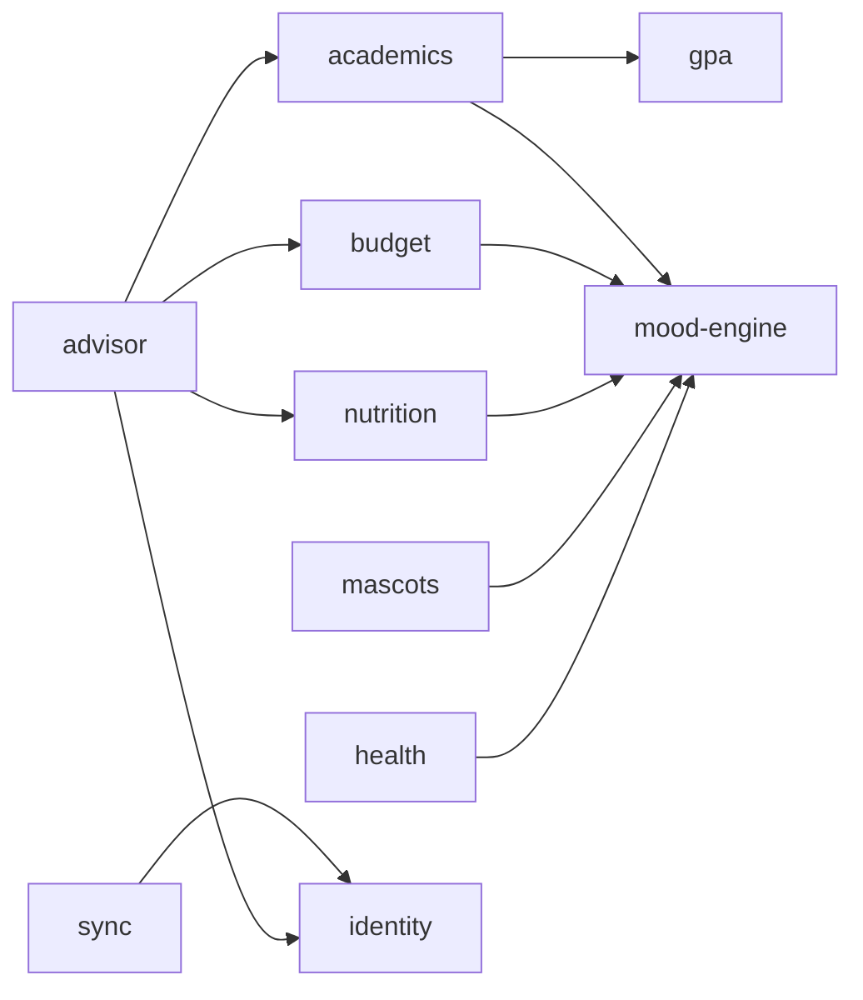

# Capability map

**Status:** Approved on 2 October 2026. This is a living document: changes go through review and are logged at the bottom.

The app is split into modules before any requirements are written, so that module boundaries and build order are decided up front instead of drifting during implementation. Module ids are permanent. Specs, plans, tests and issues refer to them, so they are never renamed.

## Modules

| Module id | Responsibility | Depends on |
|---|---|---|
| `gpa` | Monash GPA and WAM rules: grade bands and credit-point weighting. Pure logic, no UI. | none |
| `mood-engine` | Turns target vs actual vs trend into a mascot mood. Shared by every module. | none |
| `academics` | Units, assessments, marks, "what do I need on the final", grade targets | `gpa`, `mood-engine` |
| `budget` | Income, spending, categories, monthly limits in MYR | `mood-engine` |
| `nutrition` | Food log, calorie targets, Malaysian food lookup | `mood-engine` |
| `mascots` | Penguin egg, crab and Joel: art, animation states, reactions | `mood-engine` |
| `identity` | Sign-in, profile, settings | none |
| `sync` | Keeps the phone's offline data in step with the cloud, which is what makes laptop access work | `identity` |
| `advisor` | Gemini advice and YouTube picks, built from each module's summary | `identity`, `academics`, `budget`, `nutrition` |
| `health` | Steps, heart rate and sleep from Health Connect (Android only) | `mood-engine` |

## Dependency graph

Arrows point from a module to the module it depends on. Dependencies only go one way, so there are no cycles.

## Build order

1. `gpa` and `mood-engine`: pure logic, built test-first.
2. `academics`, together with the penguin egg from `mascots`.
3. `budget`, together with the crab.
4. `identity`.
5. `sync`. Laptop access arrives here.
6. `advisor`.
7. `nutrition`, together with Joel.
8. `health`.

`mascots` grows one mascot at a time alongside the module that uses it.

## Rules for module boundaries

- The contract between two modules is defined by the module that provides it. For example, the `gpa` section of the PRD defines what `academics` is allowed to call.
- The PRD gives each module its own section, keyed by module id.

## Assumptions this map rests on

1. There is one user, but with a proper login, because the data is stored in the cloud.
2. The app runs on Android (Samsung Galaxy S24 Ultra) and in desktop Chrome. No iOS.
3. The stack is Expo (React Native with web support) in TypeScript. Not yet confirmed: this becomes ADR-0001 during the TRD.
4. The app is offline-first: the phone works without internet and syncs later.
5. The backend runs on the AWS free tier, with a USD 1 budget alert.
6. Gemini is only ever called through the backend, never directly from the app.
7. Money is in MYR, times are Malaysian time, and grades use Monash's 4-point GPA (HD 4, D 3, C 2, P 1, N 0), to be checked against the current Monash handbook.
8. The user sets every target. The app may suggest defaults but never decides what "good" means.
9. Mascots start as 2D art from the user's artist friend. 3D is a stretch goal.
10. Steps come from the phone. Heart rate and sleep need a smartwatch.
11. There is no bank connection. Spending is entered by hand.

## Candidates not yet in scope

Timetable, assignment deadlines, and reminders or notifications. To be decided in the concept brief.

## Change log

| Date | Change |
|---|---|
| 2026-10-02 | First version approved. |
