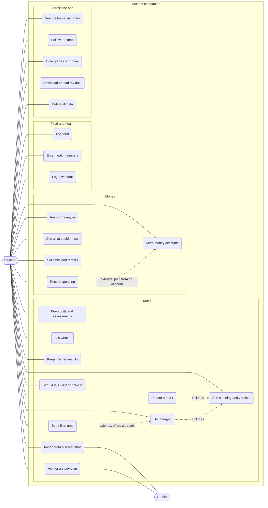

# Use cases

**Status:** Draft, 16 November 2026, updated 18 November, from the app as built.

This document answers: who does what with the system?

## Who and what is involved

| Actor | What it is | Kind |
|---|---|---|
| **Student** | The one person who uses the app | Main actor |
| **Gemini** | Google's AI service. Takes part only when a key is set and the student asks | Outside system |
| **Artist** | Supplies mascot art and icons as files. Never uses the app | Outside person, not an actor in the running system |

## Use-case diagram

Mermaid has no use-case diagram of its own, so this one is drawn as a flowchart.

## The main use cases, step by step

### UC-2: Record a mark

| | |
|---|---|
| **Goal** | The student's standing in a unit is up to date |
| **Before** | The unit and the assessment exist |
| **Stories** | ACA-05, ACA-07, ACA-09, ACA-10, ACA-14, ACA-11 |

**Main path**

1. The student opens the unit and chooses "Enter mark" on an assessment.
2. The student types the mark and what it is out of.
3. The app checks the mark is from 0 to the marks available.
4. The app saves it and works out the new standing.
5. The app shows marks earned, the average, what is needed for the target, and the two verdicts.

**Other paths**

- 3a. The mark is above the marks available: the app says so and keeps what was typed. Nothing is saved.
- 4a. The assessment has a hurdle and the mark is below it: the app shows a hurdle fail, and the target is no longer possible.
- 5a. The unit has no target: the app shows standing only, and the grade the average leads to.
- 2a. The student clears the mark: the assessment goes back to "not done".

### UC-3: Set a target

| | |
|---|---|
| **Goal** | The app judges the unit against the student's own aim |
| **Stories** | ACA-08, ACA-09, ACA-10, ACA-14, GPA-07 |

**Main path**

1. The student opens "Target and unit settings" in a unit.
2. The student types a target mark (50 for P, 60 for C, 70 for D, 80 for HD).
3. The app works out the mark needed on what is left.
4. The app shows whether it is possible, and whether it is realistic.

**Other paths**

- 2a. A final goal is set: the app has already shown a default target for each unit, which the student can accept or change.
- 4a. Not possible: the app names the highest grade still reachable.
- 4b. Possible but not realistic: the app says how many points above the student's average it needs, and names the highest realistic grade.
- 2b. The student clears the target: the verdicts disappear.

### UC-9: Import from a screenshot

| | |
|---|---|
| **Goal** | Assessments and marks are entered with less typing, and never wrongly |
| **Before** | A Gemini key is set |
| **Stories** | ACA-20, ACA-21, ACA-22 |

**Main path**

1. In a unit, the student chooses a picture and presses "Read screenshot".
2. The app sends the picture to Gemini.
3. Gemini returns a list of assessment names, weights and marks.
4. The app shows the list in a form. **Nothing is saved yet.**
5. The student corrects any mistakes and unticks rows that are not wanted.
6. The student presses "Save the ticked rows".
7. The app saves each kept row as an assessment and shows the new standing.

**Other paths**

- 2a. No internet, the daily limit is used up, or the picture cannot be read: the app says which, and nothing changes. Typing still works.
- 5a. The student presses Cancel: nothing is saved.
- 7a. A row breaks a rule (for example the weights would pass 100%): the app says which row, and the rows before it stay saved.

### UC-11: Record spending

| | |
|---|---|
| **Goal** | The month's total, pace and accounts are up to date |
| **Before** | At least one category exists |
| **Requirements** | BUD-03 to BUD-06, BUD-12 |

**Main path**

1. On Budget, the student opens the **Expenses** tab.
2. The student types what it was and the amount, and picks a category and the day.
3. The student picks the account it was paid from, or none.
4. The app checks the amount is above 0 and the day is not in the future, and saves it.
5. The app shows the new total, what is left, the daily amount and the pace verdict. The account's balance goes down.

**Other paths**

- 4a. The amount is not a number: the app says so before anything is sent.
- 5a. The category is now over its limit: it is flagged, and it appears on the home screen's attention list.

### UC-19: Keep money accounts

| | |
|---|---|
| **Goal** | The app's balances match the real accounts |
| **Requirements** | BUD-10 to BUD-14 |

**Main path**

1. On the **Overview** tab, the student adds an account: a name, a kind (bank, e-wallet, investing, cash) and what it holds now.
2. On **Banking** or **Investing**, the student picks one account. The others stay hidden.
3. The student adds money in, or moves money between two of their own accounts.
4. The app updates the balance and the total. A move between accounts is neither spending nor income.

**Other paths**

- 3a. The real balance is different: the student sets it by hand, for today or an earlier day. Moves before that day stop counting; moves after it still count.

### UC-21: See what could be cut

| | |
|---|---|
| **Goal** | The student sees which spending is worth reducing |
| **Requirements** | BUD-15 to BUD-17, BUD-19 |

1. On the **Expenses** tab, the student marks categories such as rent and fees as essential.
2. The app shows everything else over the last 3 months: per month, by category, as a map of blocks, and the places paid most.
3. The app shows the advice saved for this page (a placeholder until v0.6).

### UC-16: Follow the map

| | |
|---|---|
| **Goal** | The student sees their life so far and how today's tasks lead to the goal |
| **Requirements** | MAP-01 to MAP-05, GPA-08 |

**Main path**

1. The student opens the map. It shows the life tree: the years down the left.
2. The student presses **Open to today**. This year, its four areas, this month, this week and today open to the right.
3. The student picks a node. It opens further and its details show below.
4. The student switches to a path (studies, budget, food or health), centred on "you are here", and drags right to see what is still to come and the goal.

**Other paths**

- 4a. No final goal is set: the last stop says so and points to where to set one.
- 1a. Grades or money are hidden: those numbers are masked on the map too.

### UC-17: Hide grades or money

1. The student presses "Hide grades". ("Hide money" does the same for every amount in RM.)
2. Every mark, grade, target, GPA, CGPA and WAM is replaced by dots, on every screen.
3. The forms that would show a mark are removed.
4. The choice is remembered until the student presses "Show grades".

### UC-18: Delete all data

1. On the home screen the student opens "Delete all my data".
2. The student types the word "delete".
3. The app removes every unit, mark, result, spending entry, meal, health record and setting.
4. The app shows the empty start screen.

- 2a. Anything else is typed: nothing is deleted.

## Use cases that are planned but not built

| Use case | Version |
|---|---|
| Get spending advice written by the AI | 0.6 |
| Look up a unit in the handbook | 0.6 |
| See what a goal such as a master's needs | 0.6 |
| Import a bank statement | 0.7 |
| Sign in | 0.7 |
| Use the app with no signal and sync later | 0.7 |
| Read steps, sleep and heart rate from the phone | 0.8 |
