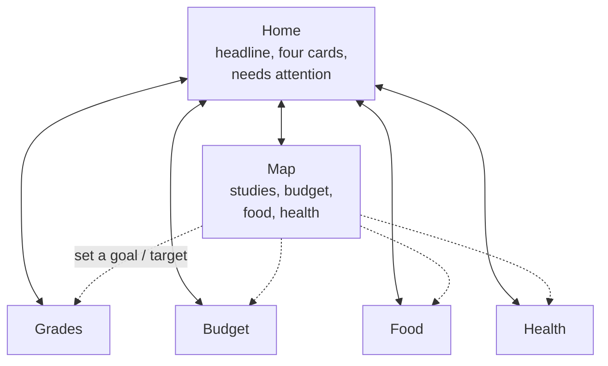
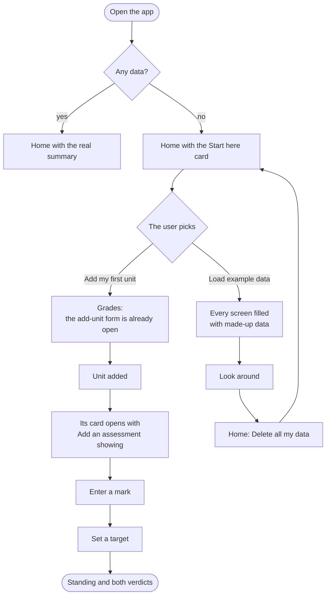
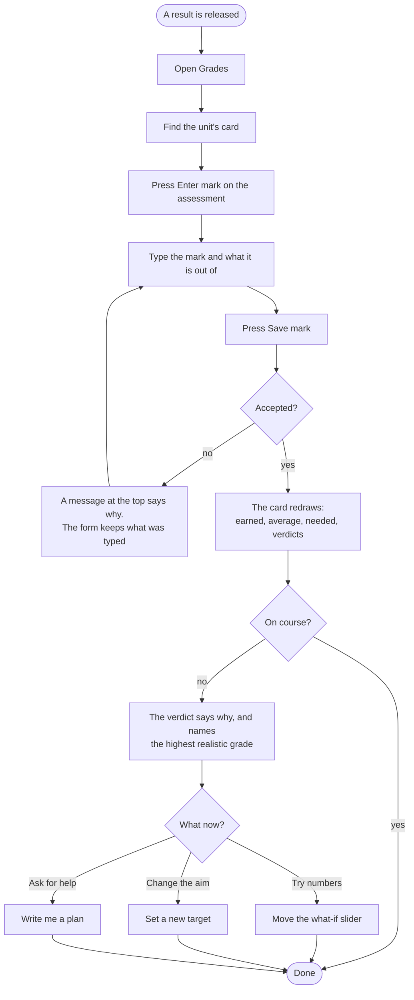
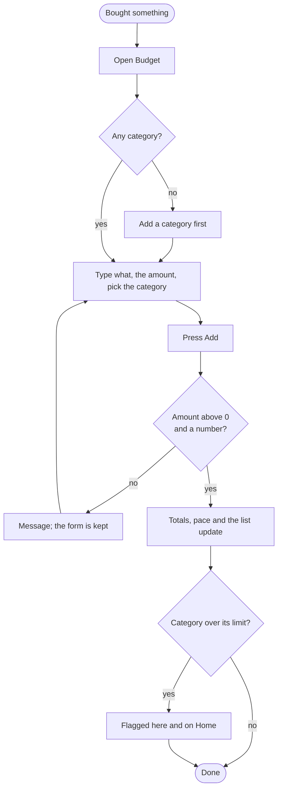
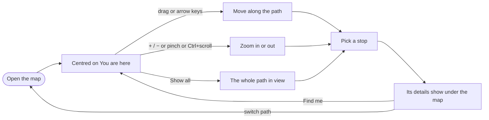

# App flow

**Status:** Draft. Written by Claude on 16 November 2026 from the app as built.

This document answers: how does a user move through the app?

## 1. The screens

- Six screens, all one press away from each other. On a phone the menu is a bar at the bottom. On a laptop it is a list at the side.
- Each screen has its own address (`#grades`, `#map` and so on), so the browser's back button works and a screen can be bookmarked.
- Three controls are always in reach: the look, hide grades, and dark mode.
- There are no pop-up windows. Forms open in place, inside the card they belong to.

| Screen | Sections, top to bottom |
|---|---|
| **Home** | Headline verdict with the penguin egg's mood. Start card (only when empty). Four area cards. Needs attention. Your data (delete everything). |
| **Map** | Path switch. How a task reaches the goal. The map. Details of the chosen stop. |
| **Grades** | CGPA, GPA, WAM. Final goal. CGPA by semester. One card per unit. Add a unit. Study plan. Finished units. |
| **Budget** | Spent, left, per day. Pace. Monthly limit. Categories. Add spending and the latest spending. |
| **Food** | Calories and protein. Daily targets. Log food and quick add. Logged today. |
| **Health** | Steps, sleep, heart rate. Today's numbers. Steps and sleep this week. Workouts. Targets. |

## 2. First run

The app never starts with data the user did not enter. The example data is offered, labelled as made up, and can be removed.

Every screen also explains itself when empty. Budget asks for a limit and a first category. Food and Health ask for targets. Without targets they still show totals, but give no verdict.

## 3. The most common task: a new mark arrives

Three presses and two numbers from opening the app to seeing the new verdict.

## 4. Adding spending

## 5. When something goes wrong

| Situation | What the user sees | What happens to the data |
|---|---|---|
| A wrong entry | A message at the top in plain words, naming what to fix. The form keeps what was typed. | Nothing is saved |
| The server is not running | "The app could not reach its server", with the command to start it | Nothing is lost |
| The grade engine is not built | Grades says so and gives the build command. Budget, Food and Health still work. | Untouched |
| The AI helper has no key | The plan card explains how to turn it on. Everything else works. | Untouched |
| The AI helper fails | A message says whether it was the connection, the daily limit or the answer | Untouched |
| An access token is needed | A form asks for it | Untouched |

Messages go in one place, at the top of the screen. Success messages are announced politely to screen readers; errors are announced at once.

## 6. Moving around on the map

Plain scrolling does not zoom the map. If it did, the page would get stuck whenever the pointer was over the map.

## 7. Screens that do not exist yet

| Screen | Why it is missing |
|---|---|
| Sign in | No hosting decision yet |
| Settings | The few settings live where they are used (targets on each screen, the look in the menu) |
| A unit's own page | A unit is one card on the Grades screen. With many units this may need its own page. |
| History (other days and months) | The data and API exist; the controls do not (task C3) |
