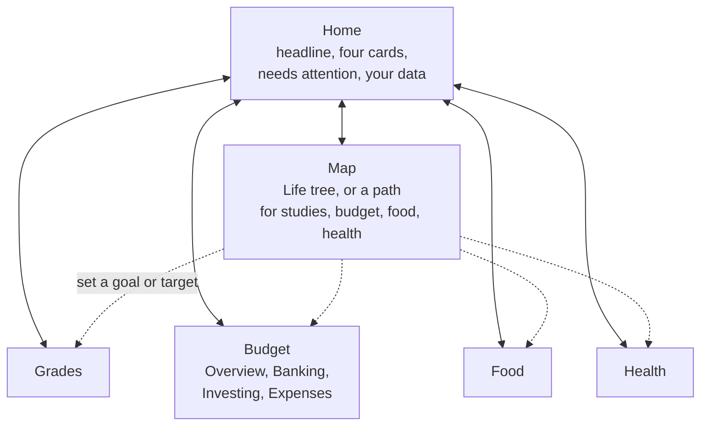
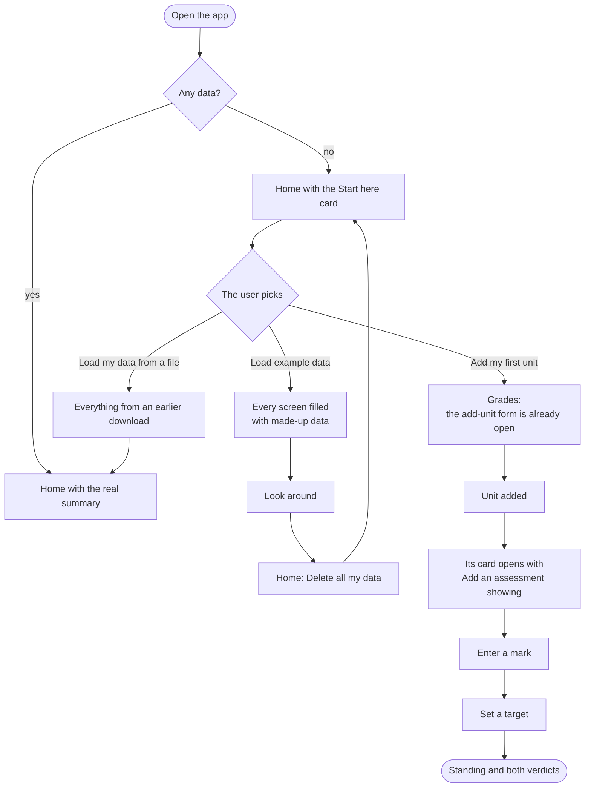
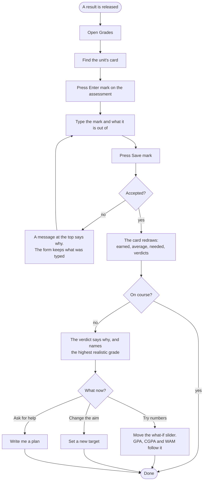
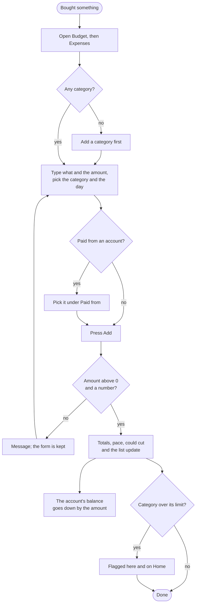
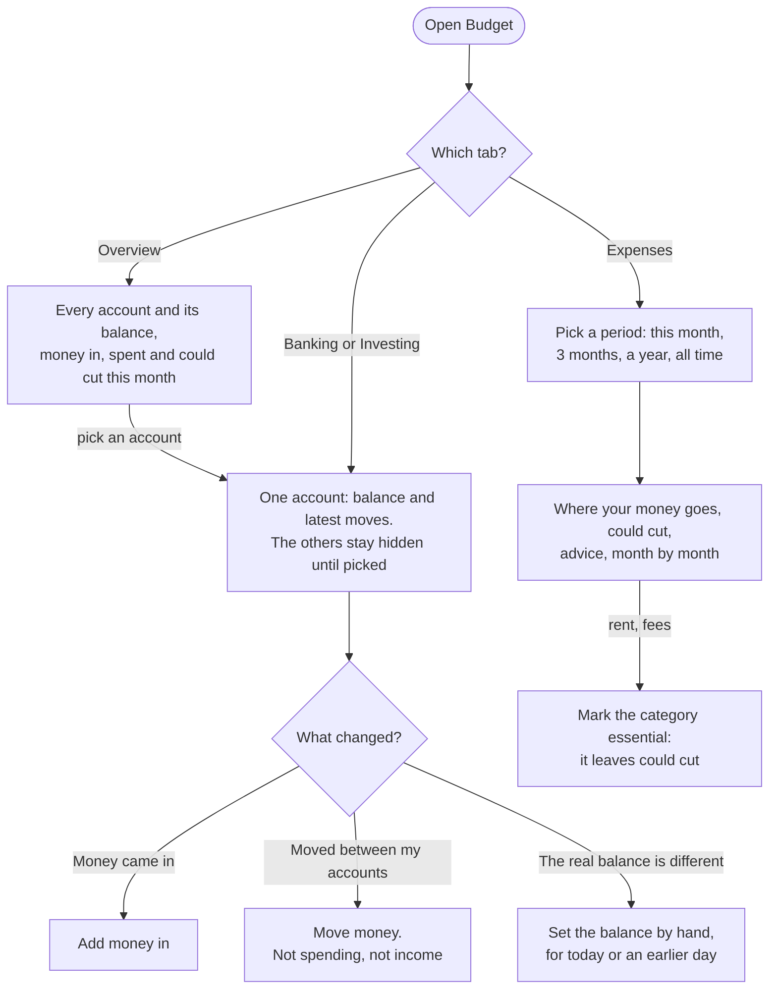
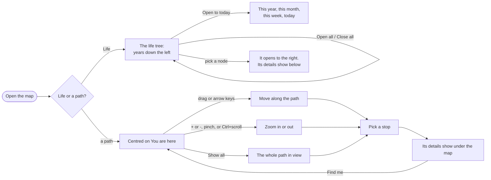

# App flow

**Status:** Draft, 16 November 2026, updated 18 November, from the app as built.

This document answers: how does a user move through the app?

## 1. The screens

- Six screens, all one press away from each other. On a phone the menu is a bar at the bottom; on a laptop it is a list at the side.
- Each screen has its own address (`#grades`, `#map` and so on), so the browser's back button works and a screen can be bookmarked.
- Four controls are always in reach: the look, the currency amounts are shown in, **Hide numbers** and dark mode.
- There are no pop-up windows. Forms open in place, inside the card they belong to.

| Screen | Sections, top to bottom |
|---|---|
| **Home** | Headline verdict with the penguin egg's mood. Start here (only when empty). Four area cards. Needs your attention. Your data: download, load from a file, delete everything. |
| **Map** | Life or a path. The life tree (years down the left, areas branching right) or the path of stops to a goal. Details of the chosen node or stop. |
| **Grades** | CGPA, GPA and WAM (they follow the what-if sliders). Final goal. CGPA by semester. One card per unit, in the order you choose. Add a unit. Study plan from the AI helper. Finished units. |
| **Budget** | Your money (total). Four tabs: **Overview** (every account, this month in short, a currency converter and the exchange rates), **Banking** and **Investing** (one account at a time), **Expenses** (the month and its limit; looking back over this month, 3 months, a year or all time with where your money goes, could cut, advice and month by month; categories, add spending, the list). |
| **Food** | Calories and protein. Log food and quick add. Change the quick-add list. Logged today. |
| **Health** | Today's steps, sleep, heart rate and water. Steps and sleep this week. Body weight with BMI. Workouts and best lifts. Targets. |

Budget, Food and Health each have **Previous** and **Next**, to look at another month or day.

## 2. First run

The app never starts with data the user did not enter. The example data is offered, labelled as made up, and can be removed.

Every screen also explains itself when empty. Budget asks for an account, a limit and a first category. Food and Health ask for targets. Without targets they still show totals, but give no verdict.

## 3. The most common task: a new mark arrives

Three presses and two numbers from opening the app to seeing the new verdict. A unit marked **pass or fail only** gets a pass or fail verdict and never changes GPA, CGPA or WAM.

## 4. Adding spending

## 5. Looking after money

A balance set for a day replaces everything before that day. Moves after that day still count, in whatever order they were typed.

## 6. When something goes wrong

| Situation | What the user sees | What happens to the data |
|---|---|---|
| A wrong entry | A message at the top in plain words, naming what to fix. The form keeps what was typed. | Nothing is saved |
| The server is not running | "The app could not reach its server", with the command to start it | Nothing is lost |
| The grade engine is not built | Grades says so and gives the build command. Budget, Food and Health still work. | Untouched |
| The AI helper has no key | The plan card explains how to turn it on. Everything else works. | Untouched |
| The AI helper fails | A message says whether it was the connection, the daily limit or the answer | Untouched |
| An access token is needed | A form asks for it. After 5 wrong tries the address is refused for 15 minutes. | Untouched |

Messages go in one place, at the top of the screen. Success messages are announced politely to screen readers; errors are announced at once.

## 7. Moving around on the map

Both maps can fill the whole page (**Full page**, Escape to leave). Plain scrolling does not zoom: if it did, the page would get stuck whenever the pointer was over the map.

## 8. Screens that do not exist yet

| Screen | Why it is missing |
|---|---|
| Sign in | No hosting decision yet (v0.7) |
| Settings | The few settings live where they are used: targets on each screen, the look and the hide switches in the menu |
| A unit's own page | A unit is one card on the Grades screen. With many units this may need its own page. |
| Import a bank statement | Planned for v0.7 (BUD-18) |
