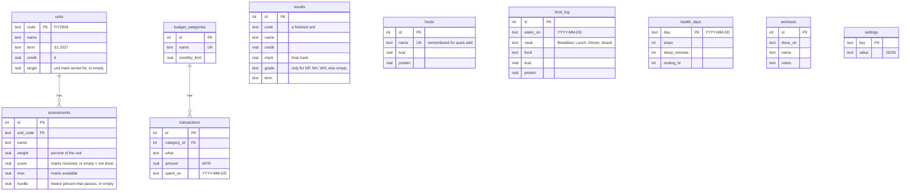

# Backend: data and API

**Status:** Draft. It describes what was built on 16 November 2026.

This document answers: what is stored, how is it laid out, and which addresses does the web app call?

## 1. What is stored



Notes:

- **Nothing worked out is stored.** GPA, verdicts, totals and summaries are calculated when asked for. So they can never be out of step with the marks.
- **Deleting a unit deletes its assessments.** Deleting a budget category deletes its spending. The database enforces this (`ON DELETE CASCADE`).
- **Days are text** in the form `YYYY-MM-DD`, worked out in Malaysian time. Text in that form sorts and compares correctly.
- **`settings` keys:** `academics.currentTerm`, `academics.margin`, `academics.goal`, `budget.limit`, `food.targets`, `health.targets`.
- **There is one user**, so no table has a user column. Adding more users means adding one to every table (see section 4).
- **Changes to the layout** are added as a new step at the end of `MIGRATIONS` in `backend/src/db.js`. The database remembers which steps it has run.

## 2. The API

Every address returns JSON. An error looks like this, with a status code of 400 or above:

```json
{ "error": { "code": "invalid", "message": "The amount must be from 0.01 to 1000000.", "field": "amount" } }
```

A change to grades returns the whole new grades report, so the screen can redraw from one answer. The same goes for budget, food and health.

### Everything

| Method and address | What it does |
|---|---|
| `GET /api/status` | Is the engine built, is the AI helper on, is the app empty |
| `GET /api/overview` | Grades, budget, food and health in one answer. Used when the app opens |
| `POST /api/demo` | Loads the example data. Only into an empty app |
| `DELETE /api/data` | Deletes everything. The body must be `{"confirm": "delete everything"}` |

### Grades

| Method and address | Body | What it does |
|---|---|---|
| `GET /api/academics` | | The full report from the engine |
| `POST /api/units` | `code`, `name`, `credit`, `term` | Adds a unit |
| `PATCH /api/units/:code` | any of `name`, `term`, `credit`, `target` (a number, or `null` to remove) | Changes a unit |
| `DELETE /api/units/:code` | | Removes a unit and its assessments |
| `POST /api/units/:code/assessments` | `name`, `weight`, and optionally `score`, `max`, `hurdle` | Adds an assessment |
| `PATCH /api/assessments/:id` | any of `name`, `weight`, `score` (`null` = not done), `max`, `hurdle` (`null` = none) | Changes an assessment |
| `DELETE /api/assessments/:id` | | Removes an assessment |
| `POST /api/results` | `code`, `name`, `credit`, `mark`, `grade`, `term` | Adds a finished unit |
| `DELETE /api/results/:id` | | Removes a finished unit |
| `PUT /api/academics/settings` | any of `currentTerm`, `margin`, `goal` (`{measure, value, totalCredits}` or `null`) | Saves the goal and settings |
| `GET /api/academics/whatif?unit=CODE&score=N` | | The final mark and grade for scoring N% on what is left. Saves nothing |

### Budget

| Method and address | Body | What it does |
|---|---|---|
| `GET /api/budget?month=YYYY-MM` | | The summary for a month (this month if left out) |
| `PUT /api/budget/settings` | `limit` (a number or `null`) | Sets the monthly limit |
| `POST /api/budget/categories` | `name`, `limit` | Adds a category |
| `PATCH /api/budget/categories/:id` | `name`, `limit` | Changes a category |
| `DELETE /api/budget/categories/:id` | | Removes a category and its spending |
| `POST /api/transactions` | `what`, `amount`, `category` (its name), `date` | Adds spending. The date cannot be in the future |
| `DELETE /api/transactions/:id` | | Removes spending |

### Food

| Method and address | Body | What it does |
|---|---|---|
| `GET /api/food?date=YYYY-MM-DD` | | The summary for a day (today if left out) |
| `PUT /api/food/settings` | `targetKcal`, `targetProtein` | Sets the daily targets |
| `POST /api/food/log` | `food`, `kcal`, `protein`, `meal`, `date`, `remember` | Logs a food. `remember: true` also saves it for quick add |
| `DELETE /api/food/log/:id` | | Removes an entry |

### Health

| Method and address | Body | What it does |
|---|---|---|
| `GET /api/health?date=YYYY-MM-DD` | | The week that holds the day |
| `PUT /api/health/settings` | `stepTarget`, `sleepTargetMinutes`, `workoutTarget` | Sets the targets |
| `PUT /api/health/days/:day` | any of `steps`, `sleepMinutes`, `restingHr` | Saves a day. Values left out are kept |
| `POST /api/workouts` | `name`, `date`, `notes` | Adds a workout |
| `DELETE /api/workouts/:id` | | Removes a workout |

### The AI helper

| Method and address | Body | What it does |
|---|---|---|
| `POST /api/advisor/plan` | | A study plan from Gemini. Answers 503 with a how-to message when no key is set |
| `POST /api/import/screenshot` | `image` (base64), `mimeType` | A list of assessments read from a picture. Saves nothing |

### Limits and checks

- A normal request body can be at most 64 KB; a screenshot at most 8 MB.
- Text is trimmed and may not contain control characters. Numbers must be finite and inside a stated range.
- When `APP_TOKEN` is set, every `/api/` call needs the header `Authorization: Bearer <token>`.

## 3. The questions the app asks its data

For a move to DynamoDB, the table is designed from this list, not from the tables above.

| # | Question | Asked by |
|---|---|---|
| Q1 | All units, each with its assessments, and all finished results, and the academics settings | Every grades screen and every grades change |
| Q2 | One unit by its code | Checks before a change |
| Q3 | One assessment by its id | Checks before a change |
| Q4 | All budget categories, and all spending in one month, newest first | Budget screen |
| Q5 | One category by name, ignoring upper and lower case | Adding spending |
| Q6 | The food log of one day, in the order it was logged | Food screen |
| Q7 | All remembered foods, by name | Food screen |
| Q8 | Health days and workouts in one week | Health screen |
| Q9 | One setting by key | Everywhere |

**A first sketch for one DynamoDB table** (to be reviewed in the hosting work, not built):

| Partition key (`PK`) | Sort key (`SK`) | Holds | Answers |
|---|---|---|---|
| `USER#<id>` | `ACA#UNIT#<code>` | a unit | Q1, Q2 |
| `USER#<id>` | `ACA#UNIT#<code>#A#<id>` | an assessment | Q1, Q3 |
| `USER#<id>` | `ACA#RESULT#<id>` | a finished unit | Q1 |
| `USER#<id>` | `BUD#CAT#<name in lower case>` | a category | Q4, Q5 |
| `USER#<id>` | `BUD#TX#<date>#<id>` | spending | Q4: "begins with `BUD#TX#2026-11`" |
| `USER#<id>` | `FOOD#LOG#<date>#<id>` | a food entry | Q6 |
| `USER#<id>` | `FOOD#ITEM#<name>` | a remembered food | Q7 |
| `USER#<id>` | `HEALTH#DAY#<date>` | a health day | Q8: a range between two dates |
| `USER#<id>` | `HEALTH#WORKOUT#<date>#<id>` | a workout | Q8 |
| `USER#<id>` | `SET#<key>` | a setting | Q9 |

Q1 becomes one query: everything that begins with `ACA#`. Every question is a query on one partition, with no scans.

## 4. If there are ever more users

- Add a user id to every table (or use the `USER#<id>` key above).
- Every query must filter by the signed-in user. The safest place is inside the store, so no route can forget it.
- The engine needs no change: it is given one user's data at a time.
