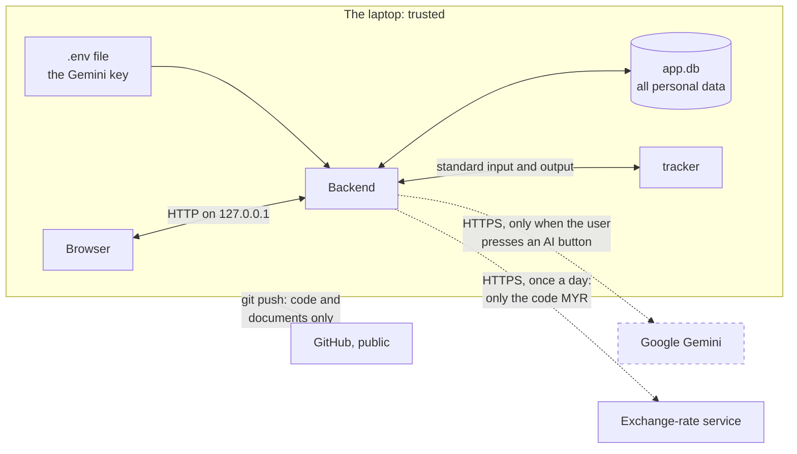

# Security and privacy

**Status:** Draft, 16 November 2026, updated 18 November. It covers the app as built: running on one laptop. Section 6 lists what must change before it goes online.

This document answers: what personal data does the app hold, where does it travel, what could go wrong, and what stops it?

## 1. What the app holds

| Data | Why it is sensitive |
|---|---|
| Marks, grades, GPA, CGPA, WAM, targets | Academic record |
| Spending, by item and day | Shows habits and location |
| Account balances, money in, bank and e-wallet records | Financial record; the names of people paid or paid back |
| Meals, calories | Health related |
| Steps, sleep, heart rate, workouts, body weight, height | Health data |

There is one user, who is also the developer. The principles of Malaysia's Personal Data Protection Act 2010 are followed anyway, because they are good habits: a clear purpose, no more data than needed, and the user in control.

## 2. Where data travels

- By default nothing leaves the laptop. The server listens on `127.0.0.1`, which other devices cannot reach.
- Two outside connections. Gemini, only when a key is set **and** the user presses "Write me a plan" or "Read screenshot". And the exchange-rate service, once a day: its address carries only the base currency code, and nothing about the user ([ADR-0008](../adr/0008-exchange-rates.md)).
- Only code and documents go to GitHub, and the repository is public. `backend/data/` and `.env` are ignored by git. The owner's bank statements, and the scripts that read them, are kept outside the repository. Tests use made-up numbers, and the unpushed changes are searched for real values before each push.
- Fonts are loaded from Google Fonts. That request carries no app data, but it tells Google that the page was opened. To avoid it, the fonts can be saved into `web/` (a small task).

## 3. What could go wrong, and what stops it (STRIDE)

STRIDE is a checklist of six kinds of threat. Each row is one threat that applies here.

| Kind | Threat | What stops it | Where |
|---|---|---|---|
| **S**poofing (pretending to be the user) | Another device on the Wi-Fi opens the app | The server only answers the laptop itself. If `HOST` is changed, the server warns when no `APP_TOKEN` is set, and with a token every API call must carry it. Tokens are compared in constant time. | `config.js`, `api.js` |
| | A web page on another site calls the API from the user's browser | The API sends no cross-origin permission headers, so browsers block other sites from reading answers. Changes need a JSON body, which a plain cross-site form cannot send. | `http.js` |
| **T**ampering (changing data) | Text typed by the user is run as code in the page (cross-site scripting) | Every user value goes through `esc()` before it becomes HTML. A content security policy blocks any script that is not one of the app's own files. Checked by hand: a unit name containing `<b>` showed as text. | `web/js/format.js`, `http.js` |
| | Input that breaks a rule (weights above 100%, a mark above its maximum) | Input is checked at the edge, and the change is rolled back unless the C++ engine accepts the result. | `api.js`, `core/` |
| | SQL injection | Every SQL statement uses placeholders. Values are never joined into SQL text. Column names in updates come from a fixed list. | `store.js` |
| | A tab or line break in a name breaks the engine's text format | Control characters are refused at the edge and replaced again before the text is built. | `http.js`, `engine.js` |
| **R**epudiation (denying an action) | Not relevant with one user | An API log line records each call (method, address, status, time), with no bodies. | `api.js` |
| **I**nformation disclosure | The Gemini key leaks | It is read from `.env`, which git ignores. It is sent only in a request header to Google, never to the browser, never in a web address, never logged. CI fails if a key or a `.env` file is committed. | `gemini.js`, `ci.yml` |
| | Personal data ends up in logs | Request bodies are never logged. | `api.js` |
| | Someone looks over the user's shoulder | "Hide numbers" masks every mark, grade, target and amount. While it is on, the page is not given the raw values at all: the edit forms are removed. A test checks that no raw mark is in the presented data. | `present.js` |
| | More data than needed goes to the AI | The plan request sends unit codes, targets, averages and verdicts. It does not send unit names, individual marks or anything about money, food or health. A test reads what is sent. | `api.js` |
| | Reading files outside the web folder through a crafted address | The path is resolved and refused unless it is inside the web folder. Tested with three kinds of `..` address. | `http.js` |
| | Old data shown from a cache, or kept on a shared computer | API answers are sent with `no-store`. The service worker never caches API calls. | `http.js`, `sw.js` |
| **D**enial of service | A huge request fills memory | Bodies are limited to 64 KB (8 MB for a screenshot). The engine has a 10-second limit. | `http.js`, `engine.js` |
| | Guessing the token again and again | After 5 wrong tokens from one address, that address is refused for 15 minutes. A test checks the sixth try gets a 429. | `api.js` |
| **E**levation of privilege | The AI changes data | The AI helper has no way to write. Its answer is text, or a list the user must confirm. | `gemini.js`, `appViewModel.js` |
| | A bug in the C++ engine is used to run commands | The engine is given data on standard input, never as command-line arguments, and it cannot start programs or open network connections. Its tests run under memory checkers in CI. | `engine.js`, `core/` |

## 4. The user stays in control

- **See it:** everything stored is shown on the screens. The database is one file that any SQLite tool can open.
- **Delete it:** "Delete all my data" on the home screen removes everything. It asks for the word "delete".
- **Keep it:** nothing is removed automatically. There is no account and no server-side copy.
- **Take it away:** "Download all my data" on the home screen exports everything to one file, which can be loaded back into an empty app.

## 5. The supply chain

- The backend and the web app use **no packages**. There is nothing to audit there.
- The C++ core uses only the standard library.
- The GitHub workflows use two actions published by GitHub itself (`actions/checkout`, `actions/setup-node`), pinned to a major version. Pinning them to an exact commit is stricter and is a small follow-up.
- The coding-assistant tools in `.claude/` were read before they were added, and their sources and licences are recorded.

## 6. Before the app goes online

These are not needed on a laptop and are **required** on the internet:

| Need | Why | Task |
|---|---|---|
| HTTPS | Otherwise anyone on the path can read marks and the token | Hosting |
| A real login in place of the shared token | A token has no expiry and cannot be changed per device | D3 |
| Secrets in the host's secret store, not in a file | A file on a server is easier to leak | D3 |
| Backups | One file is one accident away from being lost | Hosting |
| Each cloud function with only the permissions it needs | To limit what a bug can reach | D3 |

## 7. What was not checked

- No outside person has reviewed the code.
- No automated security scanner has been run.
- The repository's history was searched for the owner's real numbers once, on 18 November 2026, and two test files were corrected before they were pushed.
- The content security policy was tested in one browser (Chromium).
- The token flow was tested through the API tests, not by hand on a second device.
