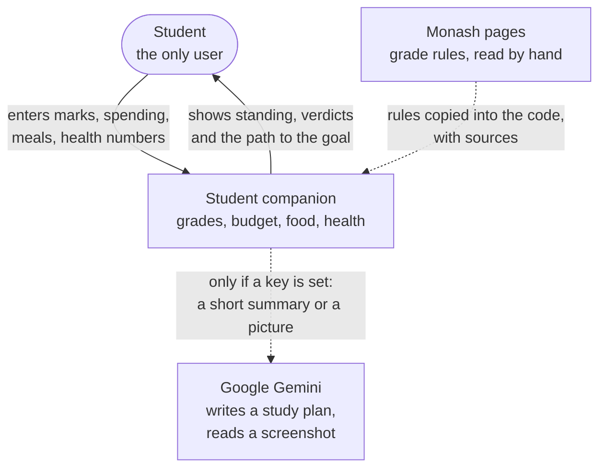
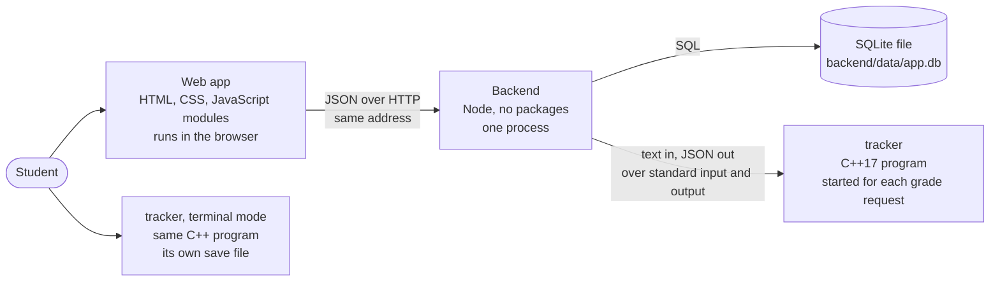
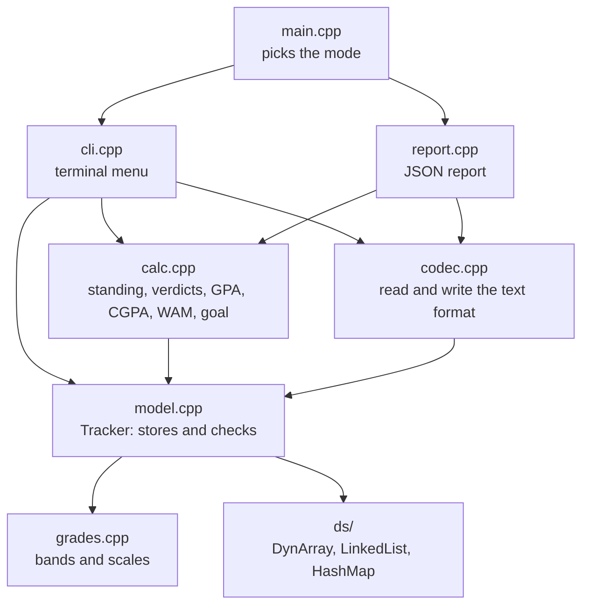
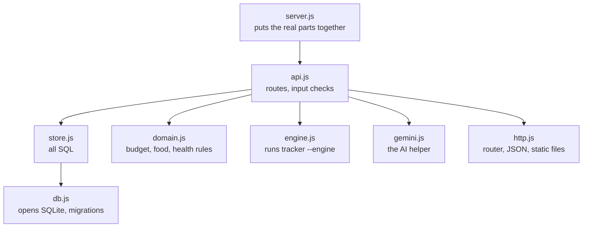
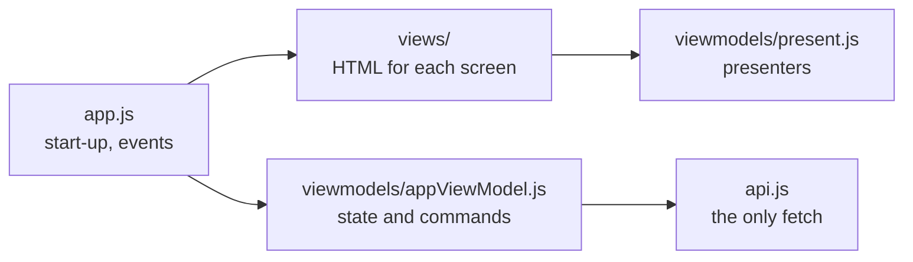
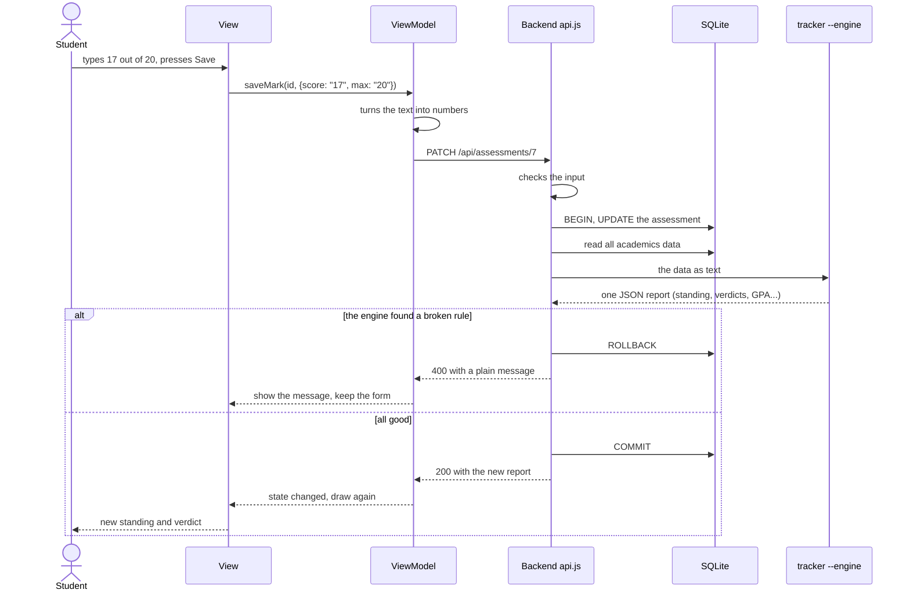

# Technical design (TRD)

**Status:** Draft. It describes what was built in the sprint of 16 November 2026. The decisions in it are recorded in ADR-0001 to ADR-0006, and numbers 0002 to 0006 still need the owner's review.

This document answers: how is the app built, and why that way?

## 1. The system from outside (C4 level 1: context)

The dotted lines are optional or manual. With no Gemini key the app talks to nothing outside the laptop.

## 2. The parts (C4 level 2: containers)

| Part | Language | Why this part exists |
|---|---|---|
| Web app | JavaScript, no framework | The screens. Phone and laptop from one codebase. |
| Backend | JavaScript on Node | Stores data, checks input, serves the web app, holds the AI key. |
| Core (`tracker`) | C++17 | Every grade rule, with hand-built data structures. |
| Database | SQLite | One file, with transactions. |

## 3. Inside each part (C4 level 3: components)

### Core

Arrows point from a file to what it uses. Nothing points upward, so the rules (`calc`, `model`, `grades`) do not know that a menu, a file or a web app exists.

### Backend

`api.js` receives the store, the engine and the AI helper as arguments. Tests hand it an in-memory database and a fake AI service. This is dependency injection, and `server.js` is the composition root.

### Web app (MVVM)

The step-by-step guide is [mvvm-guide.md](../handoff/mvvm-guide.md).

## 4. How one action travels: recording a mark

The important part is the middle: **the change is saved only if the C++ engine accepts the result.** The backend does not know that weights cannot pass 100% or that a mark cannot be above its maximum. It asks, and rolls back if the answer is no.

## 5. Design choices and their reasons

| Choice | Reason | Cost |
|---|---|---|
| Grade rules only in C++ | One source of truth. A rule cannot drift between the terminal program and the web app. | A program is started for each grade request (a few milliseconds). |
| Engine as a separate program, not a library | No native build tooling in Node. A crash in the engine cannot take the server down. | Slower than a function call. |
| Text in, JSON out | The core needs no JSON parser. The same text is the terminal program's save file, so one parser is tested twice. | Names cannot contain tabs or line breaks (checked at the edge). |
| Pure functions for rules | Same input, same output. Tests need no database and no clock. | "Today" has to be passed in everywhere. |
| Check input at the edge | `api.js` checks types and ranges once. Code inside can trust its data. | A few range checks exist in both the API and the core. The core is the one that counts. |
| Full redraw of a screen | No framework, easy to follow. | A failed command must not redraw, or typed text is lost. |
| No packages | Nothing to install, read, pin or update. | Some code that a library would give is written by hand (router, test helper). |

## 6. The data structures

All three are in `core/include/ds/`. Each file starts with its own complexity table.

| Structure | Used for | Why this one | Main costs |
|---|---|---|---|
| `HashMap` (separate chaining, FNV-1a hash, doubles at 75% full) | Units by code. Semesters by name when grouping results. | The most common action is "find the unit with this code". | Find, add, remove: O(1) on average, O(n) worst case. Space O(n + buckets). |
| `LinkedList` (singly linked, with a tail pointer and merge sort) | A unit's assessments. Sorted lists of unit codes. | Kept in the order they were added. Adding is O(1). Merge sort relinks nodes without copying. | Add: O(1). Find, remove: O(n). Sort: O(n log n), stable. |
| `DynArray` (doubles when full) | Finished results. Fields of a split line. The JSON writer's nesting. | Only added to and read from start to end. Items sit together in memory. | Read: O(1). Add: O(1) amortised. Remove: O(n). At most 2x the space. |

At real sizes (a few dozen units) no choice here changes what the user feels. The point is that each choice can be stated and defended. Benchmarks on large generated data are task C7.

## 7. What is not built

| Planned in the engineering principles | State |
|---|---|
| Offline-first with sync | Not built. The service worker opens the app offline, but data needs the server. |
| AWS (Lambda, DynamoDB, Cognito), infrastructure as code | Not built. Guide and task list: [aws-setup.md](../handoff/aws-setup.md). |
| Login | Not built. A single access token exists for use on a home network. |
| Health Connect | Not built. Health numbers are typed in. |
| Structured logs and alerts | Partly: one JSON line per API call, with no request bodies. No metrics or alerts. |
| YouTube suggestions | Not built. |

## 8. How to run, build and test

See the [README](../../README.md). One command checks everything: `python tools/check.py`.
