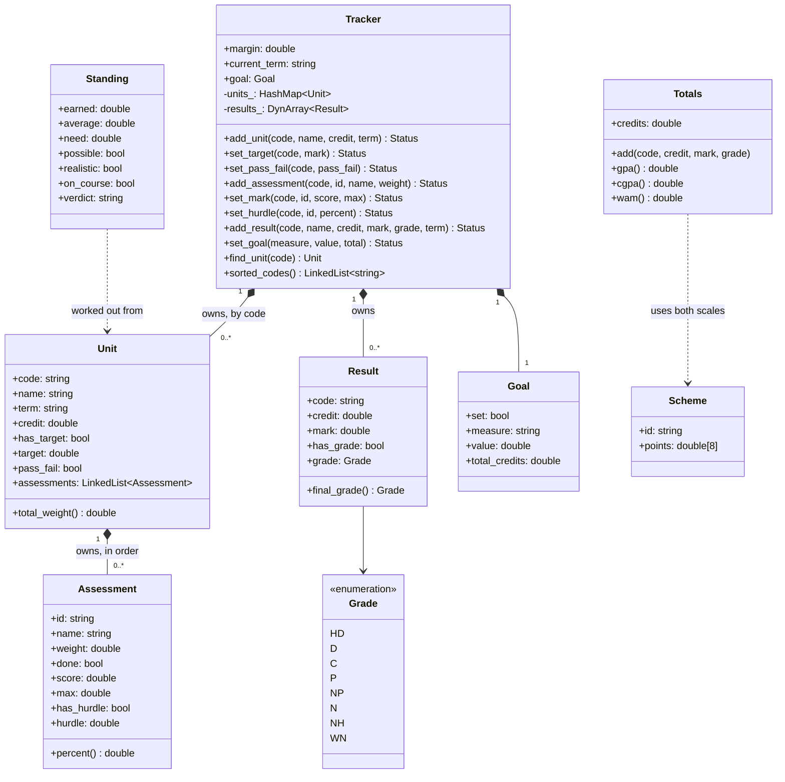
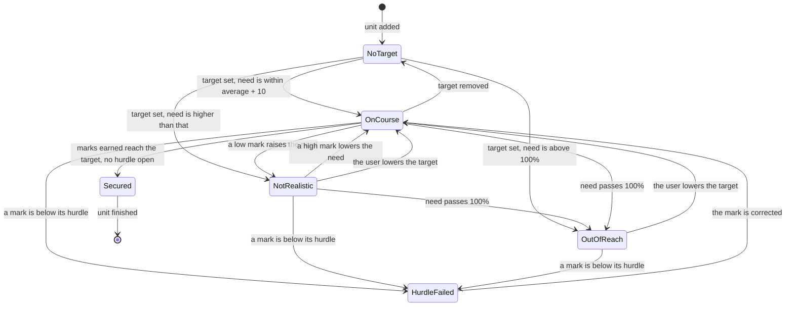
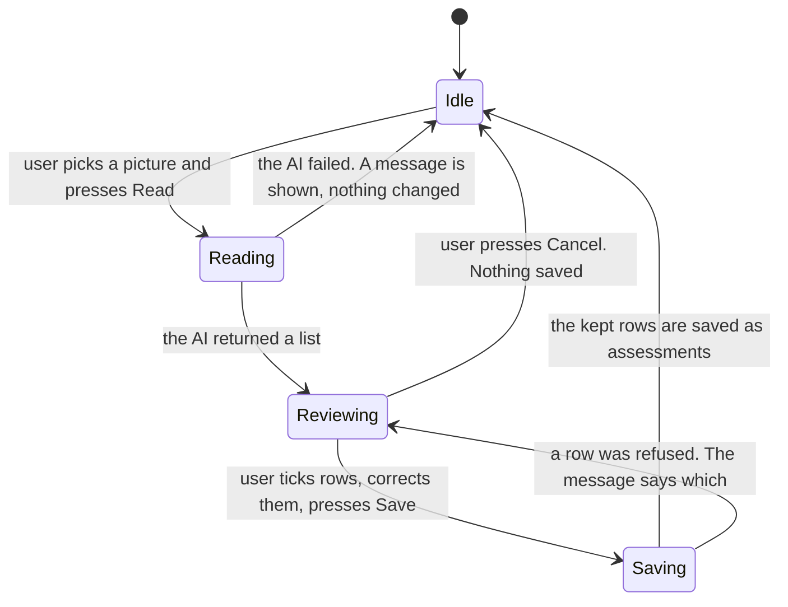
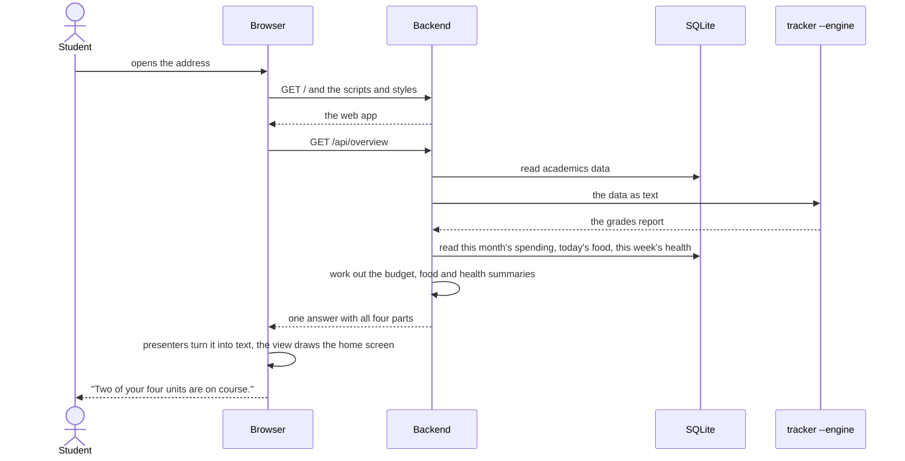
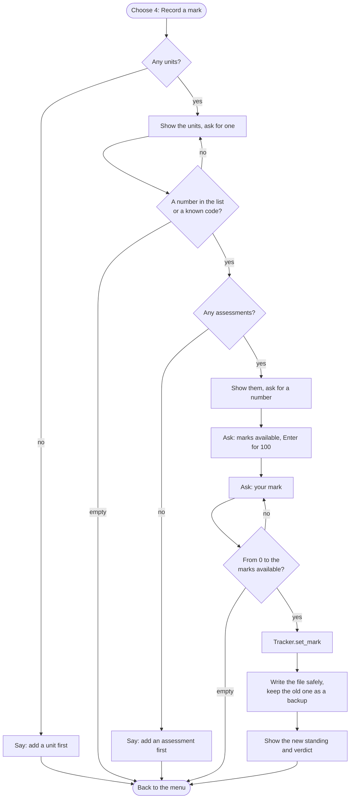
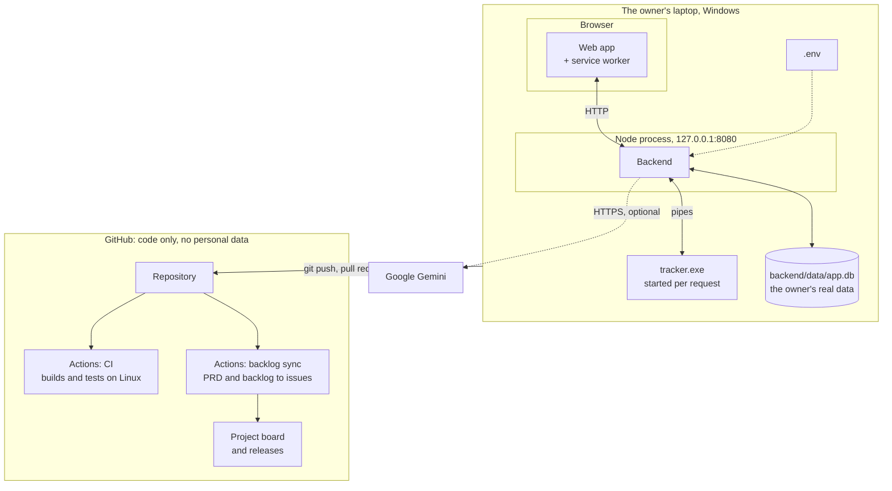
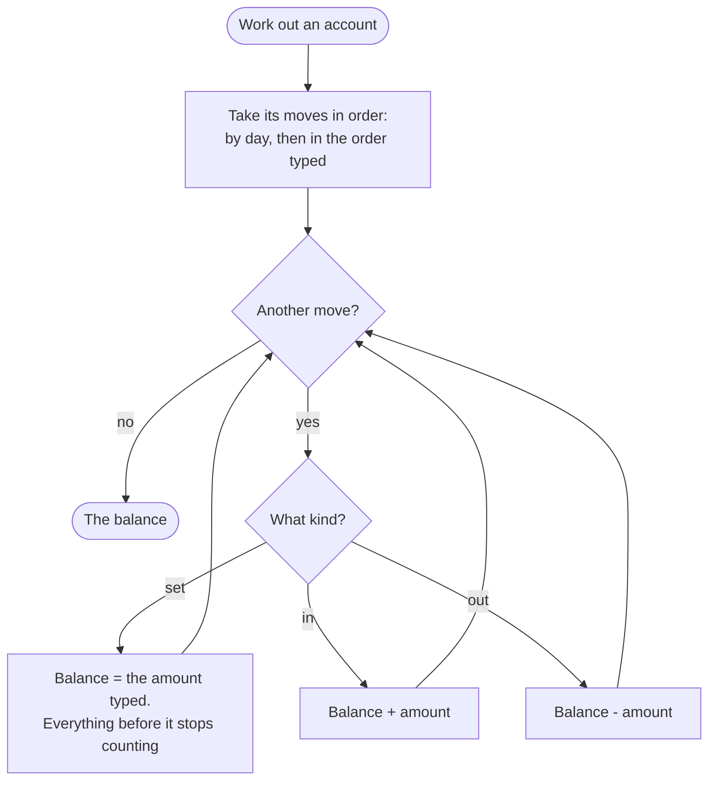

# UML diagrams

**Status:** Draft, 16 November 2026, updated 18 November. The diagrams show the code as built at version 0.3.

Each diagram answers one question. The architecture-level pictures (context, containers, components) are in the [technical design](trd.md).

## 1. Class diagram: what are the main types in the core?

How to read it:

- A filled diamond means "owns": when a `Unit` is removed, its assessments go with it.
- A dotted arrow means "uses": `Standing` is a result worked out from a `Unit`. It is not stored.
- Every method on `Tracker` that changes something returns a `Status`: empty when it worked, or a sentence saying what was wrong. This is **encapsulation**: no other code can put the tracker into an invalid state, because the fields that matter are private.
- `Scheme` is the **Strategy** idea in its simplest form: the same sum works for either scale, because the scale is passed in as data.
- A unit with `pass_fail` set is left out of `Totals` entirely, so it can never change GPA, CGPA or WAM.

## 2. State diagram: what states can a unit's target be in?

These are the same states the presenter names: `no-target`, `on-course`, `not-realistic`, `out-of-reach` and `failed`. "Secured" is shown as a chip on an on-course unit. A unit marked pass or fail only has none of these states: its verdict is just pass or fail on the average so far.

The app never stores the state. It is worked out from the marks every time, so it cannot be stale.

## 3. State diagram: a screenshot import

The point of this diagram: there is **no arrow from Reading to Saving**. What the AI reads can only be saved by going through the user.

## 4. Sequence diagram: opening the app

Recording a mark is drawn in the [technical design](trd.md#4-how-one-action-travels-recording-a-mark).

## 5. Activity diagram: what happens when a mark is entered in the terminal program

Every "no" loops back to the same question, and an empty answer always cancels. That is why wrong input cannot crash the program or leave half an action done.

## 6. Deployment diagram: what runs where today

Only code and documents go to GitHub. The database, the `.env` file and anything read from the owner's statements stay on the laptop; git ignores them. The planned cloud layout is drawn in [aws-setup.md](../handoff/aws-setup.md).

## 7. Activity diagram: how an account balance is worked out

The balance is never stored; it is worked out from the moves every time. Spending paid from an account adds an `out` move, and a move between two of your own accounts adds an `out` and an `in`, both marked as a transfer so they never count as spending or income.

This rule once took the moves in the order they were typed instead of by day. A balance set for 1 January, typed after the January top-ups, then wiped those top-ups out. It was found by loading real bank statements, and a test now covers it.

## 8. Patterns used, and where

| Pattern | Problem it solves here | Where |
|---|---|---|
| **Repository** | Hide where data is stored | `backend/src/store.js`: every SQL statement, behind plain function names |
| **Strategy** | Swap one set of values for another behind one calculation | `Scheme` in `grades.hpp`: the standard and Malaysia scales |
| **Adapter** | Wrap an outside thing in an interface the app owns | `engine.js` wraps the C++ program; `gemini.js` wraps Google's API |
| **Observer** | Let the screen react to a change without the changer knowing about the screen | `onChange` in `appViewModel.js`, drawn by `app.js` |
| **Composition root** | Put the real parts together in one place | `backend/src/server.js` and `web/js/app.js` |
| **MVVM** | Keep screen logic testable without a screen | `web/js/` |
| **Dependency injection** | Let tests swap a part for a fake | `createApp({ db, store, engine, gemini, today })`, `createAppViewModel({ api, storage })` |

Patterns from the engineering principles that were **not** needed and so were not built: a State class for the penguin egg (there is no mascot art yet), and a Factory for mascots.
