# Implementation plan

**Status:** Draft. Written by Claude on 16 November 2026, **after** most of the work it describes. The original process called for this plan to be approved before any code. On 16 November the owner chose to build first. This document records what was built and in what order, and plans what is left.

This document answers: in what order is the work done, what counts as done, what could go wrong, and what does it cost?

## 1. Definition of done

A piece of work is done when all of these are true:

1. It does what its story or task says.
2. Every rule with numbers in it has a test with a hand-worked example, including the edges.
3. `python tools/check.py` passes.
4. Anything a user typed is escaped before it is shown, and checked before it is stored.
5. It was tried by hand where it has a screen: light and dark, phone width and laptop width.
6. The documents that describe it are updated, including [STATUS.md](../handoff/STATUS.md).
7. It is committed in small commits with plain messages. Nothing secret is in the commit.
8. What was not tested is written down.

## 2. What was built, in order

Each row was built, tested and committed before the next one started.

| # | Slice | Proved by | Commit |
|---|---|---|---|
| 1 | Hand-built data structures | 24 white-box tests, leak check | `feat(core): add hand-built data structures with tests` |
| 2 | Grade rules, data model, calculations | 35 more white-box tests | `feat(core): add grade rules, the data model and the calculations` |
| 3 | Save files, the engine report, the terminal program | 13 more white-box tests, 31 black-box tests | `feat(core): add the terminal program, save files and the engine mode` |
| 4 | Backend: database, API, engine bridge, AI helper | 54 tests | `feat(backend): add the local server, database and API` |
| 5 | Web app in MVVM | 27 tests, browser checks by hand | `feat(web): add the web app in MVVM` |
| 6 | One command to check everything, and CI | The command itself | `ci: build everything and run every test on each push` |
| 7 | A cross-site protection found during the security review | 1 more test | `fix(backend): refuse changes that are not sent as JSON` |
| 8 | Handoff guides and the planning documents | Reading them | several `docs:` commits |

Why this order: each slice only needs the ones above it. The rules were built and proven before anything was put on top of them, so a bug found later could not be in the foundations without a test having missed it.

## 3. Milestones from here

```mermaid
gantt
  title What is left, in order (no dates: the owner sets the pace)
  dateFormat X
  axisFormat %s
  section Owner
  Try the app, read the ADRs       :a1, 0, 1
  Push, merge, see CI green        :a2, after a1, 1
  Check numbers against Monash     :a3, after a2, 1
  Decide name, look, hosting       :a4, after a3, 1
  section Agent, no blockers
  Browser tests in CI (C1)         :c1, after a2, 1
  Missing screen controls (C2-C4)  :c2, after c1, 1
  Export, token limit (C5, C6)     :c3, after c2, 1
  Benchmarks, accessibility (C7, C8) :c4, after c3, 1
  section Needs a decision
  Real Gemini run (D5)             :d1, after a2, 1
  Hosting and login (D3)           :d2, after a4, 2
  Mascot art (D4)                  :d3, after a4, 1
  Android and Health Connect (D6)  :d4, after d2, 2
  section Use
  Two weeks of real daily use      :u1, after a3, 2
```

| Milestone | Reached when |
|---|---|
| **M1: Reviewed** | The owner has run the app, read ADRs 0002 to 0006 and accepted or changed each one |
| **M2: On GitHub** | All five branches are merged, CI is green, the board is public |
| **M3: Trusted numbers** | One real semester gives the same CGPA as Monash's calculator |
| **M4: Daily use** | The owner has used it for two weeks of the summer semester and listed what to fix |
| **M5: Online** | The app is reachable from the phone with a login, and the bill is RM 0 |
| **M6: On the phone properly** | Installed from the home screen, with mascot art and an icon |
| **M7: Health Connect** | Steps arrive without typing |

The full task list, with who can do each one and when it counts as done, is [next-tasks.md](../handoff/next-tasks.md).

## 4. Risks

| Risk | How likely | How bad | What reduces it |
|---|---|---|---|
| **A grade rule is wrong.** The scales came from Monash's pages through a search tool, not from the pages directly, and one value (NH on the Malaysia scale) is a guess. | Medium | High: every number depends on it | The scales are data in one file. Task A4 checks against Monash's own calculator before the numbers are trusted. |
| **CI fails on Linux.** Everything was built and run on Windows only. | Medium | Low: it blocks merging, nothing is lost | The code avoids anything Windows-only. The first push will show. Fix before merging the rest. |
| **The owner cannot explain the code**, because an AI wrote it in a day. | High | High: it defeats the purpose of the project | Small files with a comment on why each exists. The MVVM guide's worked example. Task A1 and A5. Closing the board's issues one by one while reading the matching code. |
| **The decisions were not the owner's.** Five ADRs were written by Claude alone. | Certain | Medium | They are marked "Proposed". Nothing is merged until the owner reviews them. Each lists the options turned down, so changing one is a real choice. |
| **The real Gemini API behaves differently from the fake one.** | Medium | Low: the feature is optional | All Gemini code is in one file. The first real run is task D5. |
| **`node:sqlite` changes.** It is still marked experimental in Node 24. | Low | Low | Only two files use it. The Node version is stated in `package.json`. |
| **An AWS bill.** | Low if the guide is followed | Medium | A budget alert before creating anything. Serverless, pay-per-request parts only. A list of what costs money by surprise. |
| **Personal data is lost.** One SQLite file, no backup. | Medium over a year | High | Task C5 (export). Until then, copy `backend/data/app.db` somewhere safe now and then. |
| **Too many looks and features to keep correct.** | Medium | Medium | Decide the look (B2) and remove the rest. Do not add features before M4. |
| **Stacked branches merge badly.** Four branches sit on top of each other. | Low if merged in order | Medium | Merge in order with merge commits, not squash ([github-setup.md](../handoff/github-setup.md)). |

## 5. Costs

| Item | Now | Later |
|---|---|---|
| Running the app | RM 0: it runs on the laptop | RM 0 on a serverless free tier at one user, if the guide's warnings are followed |
| Tools | RM 0: compiler, CMake, Node, Python, git | Android Studio is free |
| Gemini | RM 0 on the free tier, with a daily limit | The same |
| A domain name | Not needed | Optional, about RM 50 a year, only for a nicer address |
| Google Play | Not needed | A one-time developer fee, only if the app is ever published there. Installing it on your own phone needs no fee. |

## 6. What not to do next

- **Do not add features before the owner has used what exists.** The backlog's later epics each start with an interview.
- **Do not move to the cloud to make the project look bigger.** Do it when using the app on the phone away from home is a real need.
- **Do not polish all four looks.** Pick one.
- **Do not let a second copy of a rule appear** outside the core, however small.

## 7. After release

As the planning hub says: two weeks of real daily use, then a retrospective (what went well, what did not, what to change), then a short case study for the portfolio. The case study has good material already: the two grade scales that the first assumption got wrong, and the four bugs the tests found.
