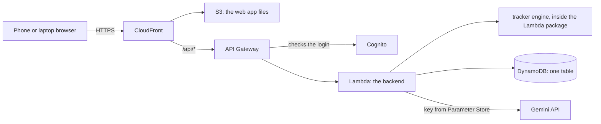

# Putting the app online (AWS)

Today the app runs on your laptop. This guide is for when you want to open it from anywhere, for example on your phone at campus.

**Nothing here has been done or tested.** It needs an AWS account, which needs your identity and a payment card. Read the whole guide before you start, because one part is a decision only you can make.

## First: the decision

There are two ways to host it. They differ in work, cost risk and what they show a recruiter.

| | Route A: one small server | Route B: serverless |
|---|---|---|
| What runs | The app exactly as it is now, on one small virtual machine | Lambda functions, DynamoDB, Cognito login, S3 and CloudFront |
| Code changes | Almost none: add a login | Large: a new storage layer, the engine packaged for Lambda, a login |
| Time | An afternoon | Several days of agent work, plus your review |
| Cost risk | A machine that runs all the time. Free only while free-tier credit lasts | Pay per request. At one user this stays at or near RM 0 |
| What it shows | "I can deploy and secure a service" | "I can design for the cloud": infrastructure as code, least privilege, access-pattern-first data design |
| Fits the original plan | No | Yes: this is what [the engineering principles](../engineering-principles.md) describe |

**Recommendation:** Route B, because it is what the project set out to show and it is the cheaper one to leave running. Use Route A only if you want the app online this week.

Record your choice as an ADR before any work starts. A draft is waiting: [ADR-0005](../adr/0005-hosting.md).

## Do this first, whichever route you take

1. **Create the AWS account** at <https://aws.amazon.com>. It asks for a card.
2. **Check the current free tier** on AWS's own free-tier page. AWS changed how the free tier works in 2025, and the details differ for new accounts. Do not trust numbers from older tutorials, including this one.
3. **Turn on a login code for the main account** (multi-factor authentication): account menu, **Security credentials**.
4. **Set a budget alert before creating anything.** In the console search for **Budgets**, create a "Zero spend" or a monthly cost budget of USD 1, and enter your email. You then get a message as soon as anything costs money.
5. **Do not use the main account for daily work.** In **IAM Identity Center** (or IAM), create a user for yourself with administrator access and use that.
6. **Pick the region closest to you** and use it everywhere: `ap-southeast-5` (Malaysia) if the services you need are offered there, otherwise `ap-southeast-1` (Singapore).

## Route A: one small server

1. In the console open **Lightsail** (simpler than EC2) and create an instance: Linux, "OS only", Ubuntu LTS, the smallest size.
2. Connect with the browser-based SSH button and install the tools:
   ```
   sudo apt update && sudo apt install -y build-essential cmake git
   curl -fsSL https://deb.nodesource.com/setup_24.x | sudo -E bash - && sudo apt install -y nodejs
   ```
3. Get the code and build it:
   ```
   git clone https://github.com/sih2006/Everything-A-Monash-Malaysia-Student-Would-Need.git app && cd app
   cmake -S core -B core/build && cmake --build core/build
   python3 tools/check.py
   ```
4. Create `.env` with `HOST=127.0.0.1`, a long `APP_TOKEN`, and your `GEMINI_API_KEY` if you use it.
5. **HTTPS is required.** Do not open port 8080 to the internet. Install Caddy (a web server that gets a certificate by itself), point a domain or a free subdomain at the instance's address, and let Caddy pass requests to `127.0.0.1:8080`.
6. Make the app start by itself with a systemd service that runs `node backend/src/server.js` in the app folder.
7. **Back up the data.** Everything is in `backend/data/app.db`. Turn on Lightsail's automatic snapshots.

**Before this is safe:** the token is one shared password with no limit on wrong guesses. Ask an agent to add a limit on failed attempts (see "Work for an agent" below) before putting personal data online.

## Route B: serverless

This is the target design. An agent can write all the code without an account; you are needed for the account, the first deploy and the review.



### What has to be built (work for an agent)

| # | Task | Where | Notes |
|---|---|---|---|
| 1 | A DynamoDB version of the store | new `backend/src/store.dynamo.js` | It must offer the same functions as `backend/src/store.js`. Design the keys from the queries first: they are listed in [backend-schema.md](../02-design/backend-schema.md). |
| 2 | Contract tests for the store | `backend/test/store.contract.test.js` | One set of tests that runs against both the SQLite store and the DynamoDB store (use DynamoDB Local in a container), so the two cannot drift apart. |
| 3 | A Lambda entry point | new `backend/src/lambda.js` | Turns an API Gateway event into the same `{ method, path, body }` the router already handles. `createApp` should not change. |
| 4 | The engine inside Lambda | build script | Compile `tracker` for Amazon Linux, fully static (`-static`), and ship it in the function package. The backend already calls it as a separate program. |
| 5 | Login | Cognito user pool with one user | API Gateway checks the token, so the app code only reads who the user is. Remove `APP_TOKEN` for this route. |
| 6 | The Gemini key | AWS Systems Manager Parameter Store (free), not Secrets Manager (paid) | Read once when the function starts. |
| 7 | Infrastructure as code | new `infra/` using the AWS CDK | Everything above defined in code, so `cdk deploy` builds it and `cdk destroy` removes it. Each function gets only the permissions it needs. |
| 8 | Deploy from CI | a new workflow | Use GitHub's OpenID Connect to let Actions deploy without storing AWS keys in GitHub. |

### What you do

1. Do the six "first" steps above.
2. Install the tools on the laptop (tell the agent first, as always): the AWS CLI and the CDK.
3. Run `aws configure sso` (or `aws configure`) to connect the CLI to your account.
4. Run `cdk bootstrap` once, then `cdk deploy`. Read the list of resources it is about to create before saying yes.
5. Create your one user in Cognito and sign in to the app.
6. Check the **Billing** page the next day, and again after a week.

### Things that cost money by surprise

Avoid these unless an ADR says otherwise: NAT gateways, EC2 instances and RDS databases left running, Secrets Manager, provisioned (not on-demand) DynamoDB capacity, CloudWatch logs kept forever (set a retention of 14 days), and public IPv4 addresses that are not attached to anything.

### To remove everything

`cdk destroy`, then check the console for anything left: S3 buckets with files in them and CloudWatch log groups are not always deleted automatically.

## Supabase and other hosts

The earlier plan listed Supabase as the alternative to AWS. It would replace DynamoDB, Cognito and Lambda with one service (Postgres, login and functions). Because every SQL statement is already inside `backend/src/store.js`, a Postgres version of the store is a smaller job than a DynamoDB one. If you prefer that route, record it in the hosting ADR. The same "what you do" idea applies: create the account yourself, never paste its keys into the repository.
