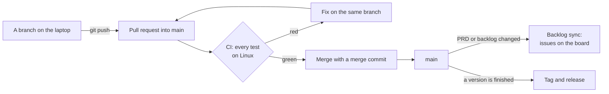

# GitHub: how the repository, CI, the board and releases work

Everything is on GitHub at [sih2006/Everything-A-Monash-Malaysia-Student-Would-Need](https://github.com/sih2006/Everything-A-Monash-Malaysia-Student-Would-Need). The repository is **public**, so only code and documents go there: never data, keys or statements.



## 1. Making a change

1. Start from an up-to-date `main` and make a branch named for the work, such as `feat/currency` or `docs/full-refresh`.
2. Commit in small steps with conventional messages (`feat(budget): ...`, `fix(...)`, `docs(...)`). Name the paths: `git commit -m "..." -- path1 path2`, because this laptop sometimes has unrelated `.claude/` files staged.
3. Push the branch and open a pull request:
   ```
   git push -u origin BRANCH-NAME
   gh pr create --base main --head BRANCH-NAME
   ```
4. Wait for CI. Merge only when it is green, with **Create a merge commit**, so every stage stays visible in the history.
5. Update the laptop: `git switch main` and `git pull`.

## 2. CI

[`.github/workflows/ci.yml`](../../.github/workflows/ci.yml) runs on every pull request and every push to `main`:

- a check that no Google key and no `.env` file is in the repository;
- the core's tests under the address and undefined-behaviour checkers;
- `python tools/check.py`: every suite (core, backend, web).

Results are in the **Actions** tab. If a run is red, open it, copy the red part of the log, and fix it on the same branch.

**One step for the owner (task A7):** protect `main`, so a red pull request cannot be merged by accident. Repository **Settings**, **Branches**, add a rule (or ruleset) for `main`, turn on **Require status checks to pass**, and pick the check named `test`.

## 3. The project board

The board is [project 1](https://github.com/users/sih2006/projects/1). It is public and linked to the repository.

- Every story in the [product backlog](../01-requirements/product-backlog.md) and every requirement in the [PRD](../01-requirements/prd.md) is one issue, filed under the milestone of its version (`v0.4 Health` and so on).
- [`tools/backlog_sync.py`](../../tools/backlog_sync.py) makes and updates the issues. The workflow [`backlog-sync.yml`](../../.github/workflows/backlog-sync.yml) runs it whenever either file changes on `main`. It never closes or deletes an issue, and it only sets a milestone when an issue is made, so moving an issue to another version on the board sticks.
- To add work: add a requirement (with its version) to the PRD, merge it, and the issue appears.
- When work is done, close its issue with a comment that names the proof: a test, a pull request, or a check by hand.

To see what the sync would do without changing anything: `python tools/backlog_sync.py --dry-run`.

**One step for the owner (task A6):** on the board, open **Workflows**, choose **Auto-add to project**, pick this repository, set the filter to `is:issue`, and turn it on. GitHub does not let a script do this.

## 4. Releases

When a version of the [roadmap](../03-plan/roadmap.md) is finished:

1. Check that its milestone has no open issues.
2. Tag the merge commit that finishes it, and push the tag:
   ```
   git tag -a v0.4.0 COMMIT -m "v0.4: food"
   git push origin v0.4.0
   ```
3. Publish the release with plain notes on what is in it:
   ```
   gh release create v0.4.0 --prerelease --title "v0.4: Food" --notes-file notes.md
   ```
   Every release before 1.0 is marked as a pre-release.
4. Close the version's milestone.

A fix after a release gets the next last number: `v0.4.1`.

## 5. Logging in on a new laptop

```
winget install --id GitHub.cli
gh auth login                      GitHub.com, HTTPS, log in with a web browser
gh auth refresh -s project         also allow the project board
```

Check that `git config user.name` and `git config user.email` match your `sih2006` account, so your commits link to your profile.
