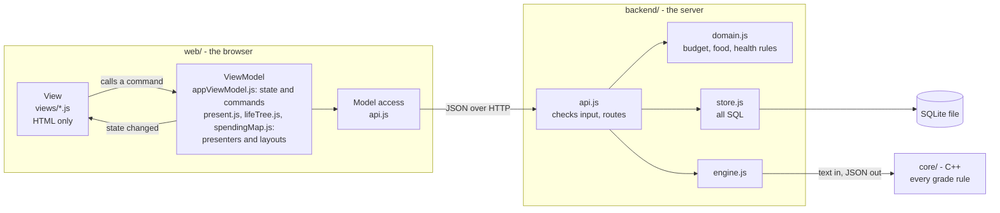

# How to add a feature (MVVM, layer by layer)

This guide explains how the code is layered and then adds one small feature from start to finish. Follow the same order for any new feature.

## The layers



| Part | Its one job | It must never |
|---|---|---|
| **View** (`web/js/views/`) | Turn state into HTML. Mark buttons and forms with `data-action`. | Call the backend, do sums, decide what a number means |
| **ViewModel: presenters** (`present.js`, `lifeTree.js`, `spendingMap.js`) | Turn backend data into finished text, tones, lists and layouts for one screen | Contain HTML, touch the page, call the backend |
| **ViewModel: commands** (`appViewModel.js`) | Check what was typed, call the API, put the answer in the state | Contain HTML, touch the page |
| **Model access** (`web/js/api.js`) | Be the only file that uses `fetch` | Know about screens |
| **API** (`backend/src/api.js`) | Check input at the edge, call store, domain and engine, return plain data | Contain SQL or a rule |
| **Domain** (`backend/src/domain.js`) | Budget, food and health rules as pure functions | Read the clock, the database or the network |
| **Store** (`backend/src/store.js`) | Hold every SQL statement | Contain a rule |
| **Core** (`core/`) | Every grade rule, in C++ | Know that a web app exists |

**Why split it this way:** each part can be tested alone, and each kind of change has one home. The presenters and commands run in plain Node with no browser, which is why the web app's 64 tests run in well under a second.

**The rule of thumb:** if you are about to write an `if` about marks, money or targets in a View, stop. It belongs in a presenter, the domain or the core.

## Worked example: "notes on a workout"

The store already keeps a `notes` column for workouts, and the API accepts it, but no screen shows or sets it. Here is how to finish that feature. It touches three layers.

### Step 1: decide where it belongs

- Is it a grade rule? No, so nothing changes in `core/`.
- Is there a rule at all? No: a note is just text. So nothing changes in `domain.js`.
- Is it stored? Yes, already. So no migration and no change in `store.js`.
- Does the API handle it? Yes: `POST /api/workouts` reads `body.notes`.
- So the work is in the web app: a command, a presenter (none needed here, the text is shown as it is), and the view.

### Step 2: write the test first

In [web/test/viewmodel.test.js](../../web/test/viewmodel.test.js), add a test that says what the command must send:

```js
test('a workout can carry a note', async () => {
  const { vm } = setup({ addWorkout: (w) => Promise.resolve({ marker: w }) });
  await vm.load();
  await vm.addWorkout({ name: 'Push day', notes: 'Bench felt heavy' });
  // The fake API hands back whatever it was sent, so the state shows what the command passed on.
  assert.deepEqual(vm.state.overview.health, { marker: { name: 'Push day', notes: 'Bench felt heavy' } });
});
```

Run `node --test` in `web/`. It fails, because the command does not pass `notes` yet. That failure is the point: it proves the test can catch the missing behaviour.

### Step 3: the command

In [web/js/viewmodels/appViewModel.js](../../web/js/viewmodels/appViewModel.js), change one line:

```js
addWorkout: (f) => act('health', () => api.addWorkout({ name: f.name, notes: f.notes ?? '' }), 'Workout added.'),
```

Run the test again. It passes.

### Step 4: the view

In [web/js/views/screens.js](../../web/js/views/screens.js), in `healthView`, add a field to the workout form and show the note in the list:

```js
${field('Notes', 'notes', 'maxlength="300"', 'optional')}
```

```js
<span>${esc(w.name)} <span class="dim">· ${esc(dayText(w.date))}${w.notes ? ` · ${esc(w.notes)}` : ''}</span></span>
```

Note the `esc()`. Anything a user typed must go through it before it becomes HTML.

The form already has `data-action="addWorkout"`. [web/js/app.js](../../web/js/app.js) sends any `data-action` to the ViewModel command of the same name, with `f` holding every field of the form, so `vm.addWorkout(f)` is called and no wiring is needed. Only commands that need more than that are listed in `COMMANDS` in `app.js`.

### Step 5: check it for real

1. Run `python tools/check.py`. Every suite must still pass.
2. Start the server, open the Health screen, add a workout with a note, reload the page, and see that the note is still there.
3. Try a note with `<b>` in it and check it shows as text, not as bold.

### Step 6: commit

```
git add web
git commit -m "feat(health): add notes to workouts" -- web
```

## The same steps when a rule is involved

If the feature had a rule (say, "warn when three workouts in a row are the same"), add two steps before step 2:

- Write the rule as a pure function in `backend/src/domain.js`, with tests in `backend/test/domain.test.js` that use hand-worked examples and the edges (two in a row, exactly three, four).
- Return its result from `healthSummary`, so the web app only has to show it.

If it is a **grade** rule, it goes in the C++ core instead: a function in `core/src/lib/calc.cpp`, tests in `core/tests/test_calc.cpp`, a new field in the JSON written by `core/src/lib/report.cpp`. The backend passes that field through untouched, and a presenter turns it into text.

If something new must be **stored**, add a new entry at the end of `MIGRATIONS` in `backend/src/db.js`. Never edit an old entry: a database that already ran it would not get the change.

## How the ViewModel tells the View to redraw

There is no framework. The whole mechanism is this:

1. `createAppViewModel({ api, storage, onChange })` gets a function, `onChange`.
2. Every command ends by calling `onChange(state, info)`.
3. In `app.js`, `onChange` is the `draw` function. It runs the screen's view function on the state and puts the HTML in the page.

So data only ever flows one way: a command changes the state, the state is drawn. A View never changes the state by itself. When a command fails, `info.failed` is true and `draw` only shows the message, so nothing the user typed is lost.

This is the "Observer" pattern in its smallest form. If the app grows, the same ViewModel can be kept and the drawing replaced by a framework, because the ViewModel knows nothing about how it is drawn.
